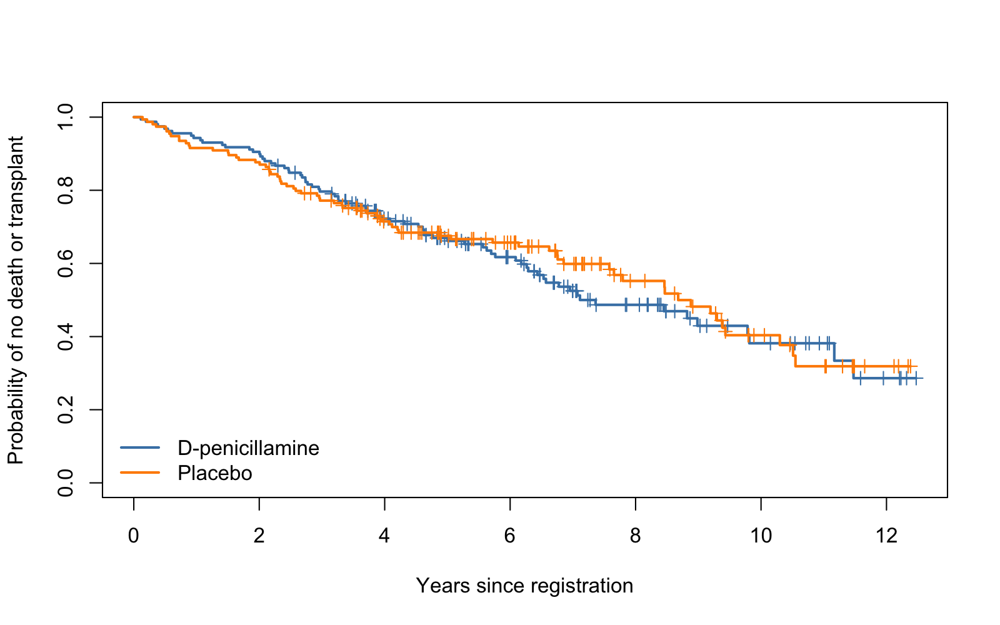

<div align="center">

# 🩺 PBC Survival Analysis

**Kaplan-Meier and Cox proportional hazards analysis of the Mayo Clinic PBC trial**


[](https://isla-yao.github.io/pbc-survival-analysis/)

</div>

---

## 📊 Overview

This project analyses survival in the Mayo Clinic randomised trial of
D-penicillamine for primary biliary cholangitis (PBC), using the `pbc`
dataset from the R `survival` package.

<p align="center">
  
</p>

## 🔍 Key findings

| Factor | Hazard ratio (95% CI) | Interpretation |
|---|---|---|
| Placebo vs D-penicillamine | 1.07 (0.77–1.50) | No treatment effect |
| Bilirubin (per doubling) | **1.95** (1.72–2.20) | Strongest risk factor |
| Albumin (per 1 g/dL) | **0.33** (0.22–0.50) | Protective |
| Age (per year) | 1.02 (1.00–1.04) | ~21% higher hazard per decade |

- Log-rank test: no difference between treatment groups (p = 0.7)
- Model discrimination: concordance = 0.82
- No evidence against the proportional hazards assumption (global p = 0.59)

## 🛠️ Methods

- [x] Data preparation (312 randomised patients; composite endpoint of death or transplant)
- [x] Kaplan-Meier curves with log-rank test
- [x] Multivariable Cox proportional hazards model
- [x] Proportional hazards checks (Schoenfeld residuals)
- [ ] Extension: longitudinal biomarker modelling with `pbcseq`

## 📁 Repository structure

```
├── analysis.qmd      # Full analysis (Quarto source)
├── analysis.html     # Rendered report
├── custom.scss       # Custom theme
├── index.html        # Redirects site homepage to the report
└── figures/          # Figures used in this README
```

## ▶️ Reproduce

1. Clone this repository and open `pbc-survival-analysis.Rproj` in RStudio
2. Install the `survival` package if needed
3. Open `analysis.qmd` and click **Render**